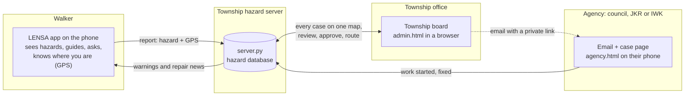
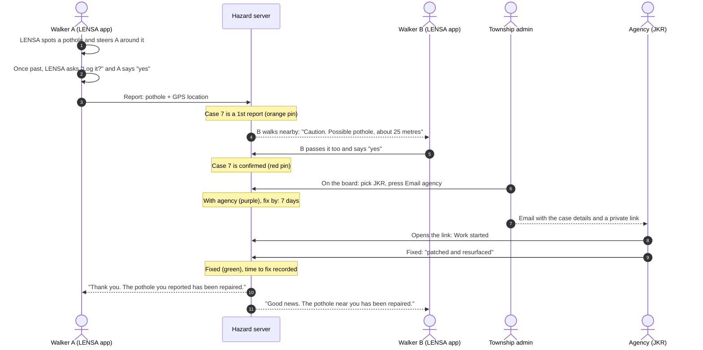
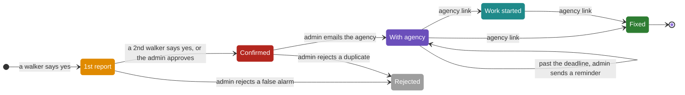

# LENSA

**See the walkway ahead, and help fix it for the next person.**

LENSA is a wearable navigation aid for blind and low-vision pedestrians. A small camera on a pair of
glasses watches the path, the phone recognises obstacles and walkway hazards, and a short voice line
tells the wearer what is there and which way to step.

For this hackathon we took LENSA one step further: every walk now feeds a shared hazard map. When LENSA
guides someone past an open drain or a missing manhole cover, it asks if they want to log it. A second
walker confirms it, the township sends it to the agency responsible, the agency marks it fixed, and
everyone who walks that route afterwards is safer for it.

Think of it as Waze for walkways, built for the people who need it most.

## Why

- With a white cane, an open drain is found at arm's length, or not at all.
- Walkway defects are easy to walk past and hard to report. Complaints end up scattered across
  hotlines, chat groups and apps, and nobody can see the whole picture.
- The person most at risk from a hazard is also the least able to photograph it and file a report.

LENSA turns the walk itself into the report.

## How it works

### The four pieces, and where they run



| Piece | Who uses it | What it does |
|---|---|---|
| **LENSA app** (Android) | the walker | Recognises obstacles and walkway hazards with the phone camera, speaks directions, and after passing a hazard asks if it should be logged |
| **Hazard server** (`server.py`) | runs on a computer or in the cloud | Stores every case, matches reports of the same hazard, keeps deadlines |
| **Township board** (`admin.html`) | township staff | One map of every hazard: review, approve or reject, email the agency, send reminders |
| **Agency page** (`agency.html`) | council, JKR, IWK crews | Opened from the email link, no login: mark work started, then fixed |

### The journey of one pothole



### What a case goes through



The colours match the pins on the maps.

### The rules, in one place

| Rule | Value |
|---|---|
| Hazards LENSA asks about | potholes, broken road, drains, open, displaced or broken manhole covers. Never people or cars |
| When it asks | after the hazard came close in the camera view and then left it for 2 seconds, so the walker is already past |
| How to answer | say "yes" or "no", or tap YES / NO. Five seconds of silence cancels |
| Same hazard | same type within **20 m**. A report from a *different* walker confirms it |
| Heads-up distance | **30 m** |
| Who fixes what | manholes: Indah Water Konsortium · potholes and roads: JKR · drains, pavements, walkways: the district council |
| Fix-by deadline | **2 days** if urgent (danger 9-10 out of 10), **7 days** otherwise, counted from the email |
| Repair news | walkers within 30 m hear it for a week, and the first reporter is thanked |

Every case keeps a timeline from first report to repair, so the board can show how long fixes take.

## How we measure the pilot

Success is safer walks, not detection scores.

| Measure | What it means |
|---|---|
| **Routes completed** | Walks finished without collision or help: cane only vs cane + LENSA |
| **Warning time** | Seconds between the alert and reaching the obstacle |
| **Hazards fixed** | Defects logged through LENSA and closed by maintenance |

## Try it

You need Python 3.9 or newer. There is nothing to install.

```bash
python server.py
```

- Walker app: <http://localhost:8000>
- Township board: <http://localhost:8000/admin.html>

**Walk through the whole loop in a few minutes:**

1. In the walker app, tap **Start walk**. With no GPS indoors, open **Test / demo backup**, tick
   **Fake GPS** and tap the map to place yourself.
2. Press **Simulate LENSA passing it** and answer **yes** (say it, tap it, or press `Y`). An orange pin appears.
3. Open the walker app again with `?user=B` on the address to be a second walker. Move close to the pin
   to hear the warning, then simulate and answer yes. The pin turns red: confirmed.
4. On the township board, press **Email agency**. The email opens as a draft in Gmail or your mail app.
5. Open the link in the email to see the agency's page. Mark the case **work started**, then **fixed**.
6. Back in the walker app, the first walker is thanked and anyone nearby hears it has been repaired.

Run `python server.py --demo` to make a day last one minute, so you can watch a case go overdue.

**With the LENSA app:** build it from `lensa/android-app` (see its README) and install it on an
Android phone on the same Wi-Fi as the computer running `server.py`. Tap **PETA BAHAYA** at the bottom,
enter the address the server prints (for example `192.168.1.20:8000`), then press **PLAY** and allow the
camera, location and microphone. Walk past a pothole or a damaged manhole cover and LENSA asks if you
want to log it; answer by voice or with the **YES / NO** buttons. The app also warns you near hazards
other walkers have logged, and tells you when they are repaired.

**On a phone, without the app:** open the address the server prints in Chrome to use the walker web app.
Phones only allow GPS and the microphone on secure (HTTPS) pages. For a local test, open
`chrome://flags` on the phone, enable **Insecure origins treated as secure** and add that address.
A hosted deployment on HTTPS would not need this.

## What's in this repository

```
server.py          hazard map server: cases, matching, routing, deadlines (Python standard library + SQLite)
web/index.html     walker app: map, voice prompt, warnings, repair news
web/admin.html     township board
web/agency.html    agency update page, opened from the email link
lensa/             LENSA itself
```

Inside `lensa/`:

- `desktop-beta/`: the full pipeline on a laptop. Camera, then two YOLO detectors (everyday obstacles,
  plus a road-hazard model for potholes, broken road and open, displaced or broken manhole covers),
  then steering rules, then a Bahasa Melayu voice line and a top-down map of the path ahead.
- `android-app/`: the same logic ported to Kotlin, running on the phone's camera, fully on-device. Two
  optional online buttons use Google Gemini to describe the scene or read a sign aloud, and
  `HazardMap.kt` connects it to the hazard map.
- `hardware/`: a 3D-printable glasses mount for the head unit (ESP32-S3, OV5640 camera, VL53L8CX depth sensor).
- `docs/`: architecture, model notes and roadmap.

See `lensa/desktop-beta/README.md` and `lensa/android-app/README.md` to run LENSA itself. Trained model
weights are not included in this repository.

## Built with

Python (`http.server`, `sqlite3`) · Leaflet with an Esri street map · Web Speech API (speech synthesis
and recognition) · Ultralytics YOLO · ONNX Runtime for Android · Kotlin · ESP32-S3 · Google Gemini

## Where it's at

This is a working prototype built for the hackathon.

- The hazard map loop works end to end: report, confirm, warn, route, fix, and tell walkers.
- The LENSA Android app is connected: it notices when you have walked past a pothole, broken road or
  damaged manhole cover, asks, logs it with GPS, and warns you near logged hazards. The laptop
  prototype (`lensa/desktop-beta`) is not connected yet; the walker web app's simulate button stands in.
- Deciding that a hazard has been "walked past" is a simple rule (it came close in the camera view,
  then left it for two seconds), tuned for a phone held pointing ahead. It needs tuning on real walks.
- The server runs on a laptop over local Wi-Fi. A city rollout would host it in the cloud on HTTPS,
  with logins for township staff.
- Agency emails are prepared as drafts and go to our own inbox for the demo. Routing uses the hazard
  type; a real deployment would use each township's own contacts.

## API

| Method | Path | Purpose |
|---|---|---|
| `POST` | `/api/detected` | LENSA reports a passed hazard `{type, danger}`, which triggers the walker's prompt |
| `POST` | `/api/report` | Walker logs a hazard `{type, danger, lat, lon, by}` |
| `GET` | `/api/hazards` | All cases with their timeline |
| `POST` | `/api/hazards/<id>/approve`, `reject`, `send`, `remind`, `fixed` | Township board actions |
| `GET` / `POST` | `/api/agency/<id>?key=...` | Agency view and update (`in_progress` or `fixed`) |

## Credits

LENSA began as a final-year project at Universiti Teknologi PETRONAS by Muhammad Hafiz Bin Razali.
Road-hazard training data comes from public Kaggle and Roboflow datasets (CC BY 4.0). Map tiles © Esri.
